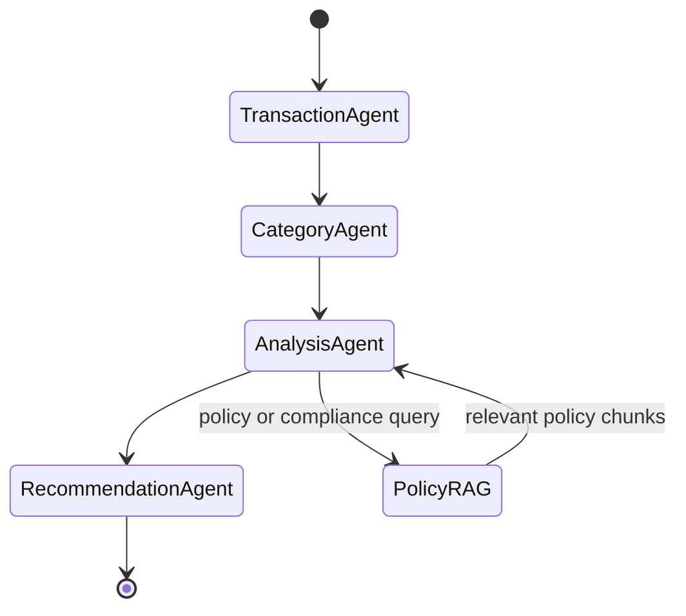

# Agentic Expense Analyzer

A Streamlit expense-intelligence application that uses specialized agents to analyze transaction data, apply expense policies, and produce recommendations.

## Features

- Load and validate CSV transactions.
- Categorize expenses with an LLM.
- Calculate spending totals, categories, patterns, and anomalies.
- Retrieve relevant expense policies with Chroma and Gemini embeddings.
- Generate personalized recommendations.
- Display agent, transaction, category, and RAG outputs in Streamlit.

## Architecture

```text
CSV transaction data
        |
        v
Transaction Agent
        |
        v
Category Agent
        |
        v
Analysis Agent <---- Policy RAG knowledge base
        |
        v
Recommendation Agent
        |
        v
Streamlit expense chatbot
```

### LangGraph state image



## Requirements

- Python 3.10 or newer
- Gemini API key
- Internet access for Gemini chat and embedding requests

Install dependencies:

```powershell
pip install -r requirements.txt
```

## Environment variables

Create a `.env` file in the project root. Do not commit it.

```env
gemini_api_key="your-rag-embedding-key"
gemini_api_key2="your-chat-model-key"
```

The application uses `gemini_api_key2` for Gemini chat requests and falls back to `gemini_api_key` if needed. The original `gemini_api_key` is used for RAG embeddings.

Never commit or share API keys. Rotate any key that has been exposed.

## Run the application

```powershell
streamlit run app.py --server.fileWatcherType none
```

Open the local URL shown by Streamlit, usually `http://localhost:8501`.

## Run the debug pipeline

```powershell
python debug_pipeline.py
```

This runs the transaction, category, analysis, and recommendation agents sequentially and stops at the first failure.

## Data

The default input file is:

```text
expense_transactions_3_months_2026.csv
```

Expected columns:

```text
transaction_id,date,description,amount,payment_method,merchant,location,transaction_type
```

## RAG policy retrieval

Policy content is loaded from:

```text
expense_income_policy_rag_knowledge_base.txt
```

Documents are split into chunks, embedded with `models/gemini-embedding-001`, and stored in the local Chroma database under `rag_vector_db/`. Policy retrieval is used for questions about compliance, limits, approvals, eligibility, and violations.

## Available tools

- `load_transactions`: validates and loads the CSV.
- `filter_transactions`: filters by date, merchant, amount, payment method, or transaction type.
- `retrieve_policy_context`: retrieves relevant policy chunks and semantic relevance scores.

## Example questions

```text
How much did I spend in total?
Where am I spending the most money?
How much did I spend on food delivery?
Show my spending by category.
Analyze my expenses for July.
Did I violate the food and transportation expense policies?
Which merchants received the most money?
How can I reduce my expenses next month?
```

## Validation

Compile the Python files with:

```powershell
python -m py_compile .\app.py .\model.py .\schemas.py
```
