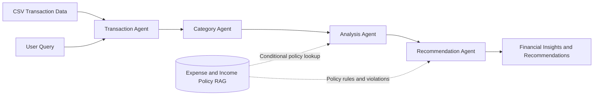

Problem Statement:


Build an Agentic AI system that analyzes expense or transaction data provided by the user to:
- Categorize where money is being spent.
- Analyze spending patterns, frequency, and daily, weekly, and monthly behavior.
- Check expenses against defined rules and policies.
- Detect unusual, unnecessary, or policy-violating expenses.
- Provide useful and personalized recommendations.

The system is divided into four specialized agents:
1. Transaction Agent
2. Category Agent
3. Analysis Agent
4. Recommendation Agent

There is also a RAG-based Expense Policy knowledge source, which provides the rules/policies that the agents can refer to when evaluating expenses.

RAG: Expense and Income Policies
The RAG knowledge source contains the rules and policies that the system uses to check whether an expense is allowed, whether an income transaction is valid, or whether either transaction violates a rule.
For example, it can contain:
- Travel limits → Flight, train, taxi limits
- Hotel limits → Maximum allowed hotel cost per night
- Food limits → Maximum meal allowance
- Transportation rules → Allowed taxi/ride expenses
- Entertainment rules → Allowed or restricted expenses
- Approval rules → Expenses requiring approval
- Expense categories → Which expenses are allowed/not allowed
- Spending limits → Daily, monthly, or category-wise limits
- Restricted expenses → Personal shopping, alcohol, etc.
- Income sources → Salary, freelance payments, reimbursements, and other income
- Income validation rules → Rules for identifying and validating income transactions
- Income reporting rules → Requirements for recording and reporting income

Project Goal
    Convert raw expense transactions into meaningful financial insights and actionable recommendations.

Instead of making one large AI agent responsible for everything, the work is divided into specialized agents.

For example, a user may provide:
"Here are my expenses from this month."

The system should ultimately be able to answer things such as:
- How much did I spend?
- Where did I spend the most?
- Which expenses belong to which categories?
- Did I exceed any expense policy?
- What are my spending patterns?
- Which expenses look unusual?
- How can I reduce unnecessary spending?
- What should I change next month?
So the overall flow is essentially:
Raw Expenses → Understand Transactions → Categorize → Analyze → Recommend



Main User Input
The starting input to the system is the user's expense/transaction data for a specific period, such as 3 months. in the csv format

transaction_id,date,description,amount,payment_method,merchant,location,transaction_type
TXN001,2026-07-01,Uber ride,450,Credit Card,Uber,Kakinada,Expense
TXN002,2026-07-02,Dinner at restaurant,1800,Credit Card,ABC Restaurant,Kakinada,Expense
TXN003,2026-07-05,Amazon purchase,2500,UPI,Amazon,Online,Expense
TXN004,2026-07-10,Electricity bill,2200,UPI,APSPDCL,Kakinada,Expense
TXN005,2026-07-15,Netflix subscription,649,Credit Card,Netflix,Online,Expense

- transaction_id → identifies each transaction
- date → enables daily/weekly/monthly analysis
- description → helps categorize the expense
- amount → spending amount
- payment_method → analyzes payment behavior
- merchant → identifies the business/service
- location → enables location-based analysis
- transaction_type → identifies whether the transaction is an Expense or Income, allowing future flexibility

3. Main User Query
The user's query is the intent or question they want the system to answer.
For example:
"Analyze my expenses for September."

or:
"Where am I spending the most money?"

or:
"Did I violate any company expense policies?"

or:
"How can I reduce my expenses next month?"

So there are two important things:
Data
What happened?
Uber – ₹450
Restaurant – ₹1,800
Amazon – ₹2,500
Flight – ₹8,000

User Query
What does the user want to know about those expenses?
"Analyze my spending."

The system should use both the expense data and the user's query to determine what analysis is required.

4. Expected Overall Output
The final output should be an expense intelligence report/answer, rather than simply returning processed transactions.
For example:
September Expense Summary
Total spending: ₹42,500
Highest category: Travel — ₹15,200
Food spending: ₹8,400
Entertainment: ₹5,100
Policy violations: 2 transactions
Unusual spending: ₹6,000 increase in travel expenses compared with the previous month.
Recommendation: Reduce discretionary food and entertainment spending by approximately ₹3,000 next month.

The exact output depends on what the user asks.

### 1. Transaction Agent — Role & Responsibilities

### Role
**Extract and prepare the relevant transaction information from the user's CSV based on the user's query, and return it in a structured format.**

### Inputs
- User's CSV transaction data
- User's query

### Responsibilities
1. Read and parse the transaction data.
2. Understand the user's query to determine what transaction information is required.
3. Filter transactions based on query conditions such as:
   - Date/time period
   - Merchant
   - Minimum or maximum amount
   - Payment method
   - Transaction type
4. Validate and clean the required transaction data.
5. Detect duplicate or invalid transactions when necessary.
6. Return the relevant transactions in structured JSON format.
7. Pass the structured transactions to the Category Agent.

### Important
The Transaction Agent does not:
- Decide the expense category; this is the Category Agent's responsibility.
- Analyze spending patterns; this is the Analysis Agent's responsibility.
- Decide recommendations; this is the Recommendation Agent's responsibility.

### Tool
The Transaction Agent can use the following tools:

```text
load_transactions()
```

Loads the user's CSV data.

```text
filter_transactions(
    date_from,
    date_to,
    merchant,
    min_amount,
    max_amount,
    payment_method,
    transaction_type
)
```

The Transaction Agent decides which filters to apply based on the user's query. If the query does not specify a filter, the agent does not apply that filter unnecessarily.

For example, for the query "Analyze my expenses for July", the agent determines:

```json
{
  "date_from": "2026-07-01",
  "date_to": "2026-07-31"
}
```

The tool then extracts the July transactions.

### Tool Output
The Transaction Agent returns structured JSON, for example:

```json
{
  "query": "Analyze my expenses for July",
  "filters_applied": {
    "date_from": "2026-07-01",
    "date_to": "2026-07-31"
  },
  "transactions": [
    {
      "transaction_id": "TXN001",
      "date": "2026-07-01",
      "description": "Uber ride",
      "amount": 450,
      "payment_method": "Credit Card",
      "merchant": "Uber",
      "location": "Kakinada",
      "transaction_type": "Expense"
    },
    {
      "transaction_id": "TXN002",
      "date": "2026-07-02",
      "description": "Dinner at restaurant",
      "amount": 1800,
      "payment_method": "Credit Card",
      "merchant": "ABC Restaurant",
      "location": "Kakinada",
      "transaction_type": "Expense"
    }
  ],
  "total_transactions": 2
}
```

**Transaction Agent:** Understands the user's query, extracts the relevant transactions from the CSV using tools, validates and structures them, and passes them to the Category Agent.

## 2. Category Agent — Role & Responsibilities

### Role
**Categorize each relevant transaction into an appropriate spending category based on the transaction details.**

### Input
- Structured transactions from the **Transaction Agent**
- User query, if a specific category is mentioned

### Responsibilities
1. **Understand the transaction** using its description, merchant, and other available details.
2. **Assign an appropriate category** such as:
  - Food
  - Transport
  - Shopping
  - Travel
  - Utilities
  - Entertainment
  - Healthcare
  - Subscriptions
  - Other
3. **Handle ambiguous transactions** by selecting the most suitable category or `Other`.
4. **Focus on a specific category** when the user's query explicitly asks for one.
5. **Return categorized transactions in structured JSON.**
6. **Pass the categorized data to the Analysis Agent.**


### Analysis Agent

**Role:**
Analyze categorized expense data **according to the user's query** and generate relevant, evidence-based financial insights.

**Responsibilities:**
- Take categorized transaction data from the Category Agent.
- Understand the user's query and determine what analysis is required.
- Calculate relevant expense metrics based on the query.
- Analyze category-wise spending when required.
- Identify spending patterns, trends, or anomalies when relevant.
- Compare expenses with expense policies when the user's query requires policy evaluation.
- Retrieve relevant expense-policy information from the **Expense Policy RAG** when required.
- Generate clear, evidence-based insights that directly answer the user's query.

**Input:**
1. **Categorized transactions** from the Category Agent.
2. **User query/intent** — determines what needs to be analyzed.
3. **Expense Policy RAG** — a conditional knowledge source accessed only when the user's query requires policy information; it is not a permanent input to the Analysis Agent.

**Output:**
- **Relevant expense analysis and insights answering the user's query.**

## 4. Recommendation Agent — Role & Responsibilities

### Role
**Convert the analysis results into useful, personalized, and actionable recommendations based on the user's spending behavior and applicable expense policies.**

### Inputs
- Analysis results from the **Analysis Agent**
- Policy violations and rules from the **RAG Expense Policy Knowledge Source**
- User query
- Categorized transaction data when needed for context

### Responsibilities
1. **Understand the analysis results** — spending totals, categories, trends, frequency, and unusual expenses.
2. **Identify areas for improvement** such as high or unnecessary spending.
3. **Consider policy violations** identified using the Expense Policy knowledge source.
4. **Generate personalized recommendations** based on the user's actual spending.
5. **Suggest specific actions** to reduce unnecessary spending or improve spending behavior.
6. **Answer the user's original query** with relevant recommendations.

### Example
**Analysis:**

```text
Food spending: ₹8,400
Entertainment: ₹5,100
Food spending increased by 25%
```

**Recommendation:**

```text
You spent ₹8,400 on food this month.
Consider reducing restaurant spending by ₹2,000 next month
and setting a monthly food budget of ₹6,400.
```